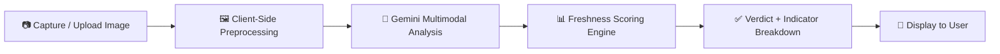

<div align="center">
  
</div>

<h1 align="center">🐟 Fish2Fresh</h1>

<p align="center">
  <strong>AI-powered fish freshness assessment for wet markets — scan, analyze, and verify in seconds.</strong>
</p>

<p align="center">
  <a href="#-overview"></a>
  <a href="#-tech-stack"></a>
  <a href="#-tech-stack"></a>
  <a href="#-tech-stack"></a>
  <a href="#-license"></a>
  <a href="#-contributing"></a>
</p>

<p align="center">
  <a href="#-overview">Overview</a> •
  <a href="#-key-features">Features</a> •
  <a href="#-how-it-works">How It Works</a> •
  <a href="#-getting-started">Getting Started</a> •
  <a href="#-project-structure">Project Structure</a> •
  <a href="#-roadmap">Roadmap</a> •
  <a href="#-contributing">Contributing</a>
</p>

---

## 📖 Overview

**Fish2Fresh** is an intelligent web application that helps consumers, market vendors, and food-safety inspectors determine the freshness of fish in **wet markets** — instantly, using nothing more than a smartphone camera.

By combining on-device image capture with Google's **Gemini** multimodal vision models, Fish2Fresh evaluates visual freshness indicators (eye clarity, gill color, skin texture, scale integrity, and body firmness) and returns a **clear, actionable freshness score** — no lab equipment, no guesswork, no middleman.

> **Why it matters:** Wet markets remain the primary source of fresh protein for billions of people, yet freshness is almost always judged subjectively. Fish2Fresh brings a consistent, transparent, and accessible standard to the point of sale.

---

## ✨ Key Features

| Feature | Description |
| :--- | :--- |
| 📸 **Instant Scanning** | Capture or upload a photo of fish directly from your phone or desktop browser. |
| 🧠 **AI Freshness Analysis** | Multimodal Gemini models assess eye, gill, skin, and scale condition in real time. |
| 📊 **Freshness Score** | A normalized 0–100 score with a categorical verdict: *Excellent · Good · Fair · Poor · Reject*. |
| 🔍 **Explainable Results** | Per-indicator breakdown so users understand *why* a fish received its score. |
| 🛒 **Market-Ready UX** | Designed for fast, one-handed use in noisy, high-traffic wet market environments. |
| 🌐 **Runs Anywhere** | Fully client-side deployment — no backend infrastructure required. |
| 🔒 **Privacy-First** | Images are processed for analysis and are not persisted to any database. |

---

## 🧪 How It Works



## Local Development

### Requirements

- Node.js 20 or newer
- npm (included with Node.js)

### Run locally

Install the locked dependencies and start the development server:

```sh
npm ci
npm run dev
```

Open the local URL printed by Vite (by default, `http://localhost:3000`). The landing page does not require an API key or `.env.local` file.

### Build and preview

```sh
npm run lint
npm run build
npm run preview
```

`npm run clean` removes generated build output and the optional `server.js` file.
